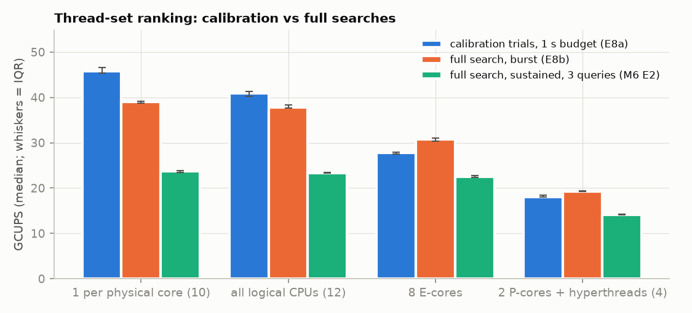

# E8 — Thread-set calibration (generated by `scripts/make_e8_report.py`)

Question, expectations and design: `PLAN.md` (written before the run) and `DECISIONS.md` D5. All numbers measured on the student's laptop (i3-1220P), AC power. GCUPS counts real cells only.

## E8a — Repeatability: 10 calibrations per budget (Swiss-Prot, 20 s idle before each)
Recorded 2026-11-21T19:07:35+05:30: platform profile `balanced`, governor `powersave`, long-term power limit 15.0 W (MMIO zone; window 28.0 s), on AC: 1, package temperature at start 70.0 °C.

| Budget (s) | Runs | Chosen | Fastest median | Wall time, median (min–max) s | physical / all, median ratio (min–max) |
|---|---|---|---|---|---|
| 0.25 | 10 | physical 10 | physical 10 | 0.28 (0.26–0.36) | 1.054 (1.011–1.807) |
| 1 | 10 | physical 10 | physical 10 | 0.89 (0.70–1.41) | 1.131 (1.094–1.148) |
| 3 | 10 | physical 10 | physical 10 | 3.08 (2.42–4.07) | 1.079 (1.034–1.128) |

Each calibration: 5 rounds, sets in rotated order, query = the Swiss-Prot sequence closest to length 400, decision margin 5% (keep `physical` unless another set's median is more than 5% faster).

Per-set calibration speed, median over the 10 runs of each run's median GCUPS:

| Budget (s) | 1 per physical core (10) | all logical CPUs (12) | 8 E-cores | 2 P-cores + hyperthreads (4) |
|---|---|---|---|---|
| 0.25 | 45.5 | 43.7 | 28.0 | 17.5 |
| 1 | 45.8 | 41.0 | 27.7 | 18.1 |
| 3 | 41.4 | 38.3 | 29.4 | 19.3 |

## E8b — Ground truth: one full Swiss-Prot search per run, query length 400, burst regime (20 s idle before each)
Recorded 2026-11-21T19:18:20+05:30: platform profile `balanced`, governor `powersave`, long-term power limit 15.0 W (MMIO zone; window 28.0 s), on AC: 1, package temperature at start 47.0 °C.

| Thread set | Median time (s) | IQR % | GCUPS | Regret vs best |
|---|---|---|---|---|
| 1 per physical core (10) | 2.14 | 1.4 | 39.03 | +0.0% |
| all logical CPUs (12) | 2.21 | 1.8 | 37.80 | +3.3% |
| 8 E-cores | 2.73 | 1.9 | 30.70 | +27.1% |
| 2 P-cores + hyperthreads (4) | 4.33 | 0.5 | 19.31 | +102.2% |

Rounds: 5, random order per round.

Sustained-regime reference (M6 E2, 3 queries 150/400/990, 2 s conditioning before each run): 1 per physical core (10) 23.7, all logical CPUs (12) 23.3, 8 E-cores 22.6, 2 P-cores + hyperthreads (4) 14.1 GCUPS.

