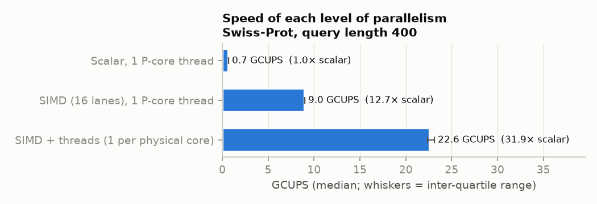
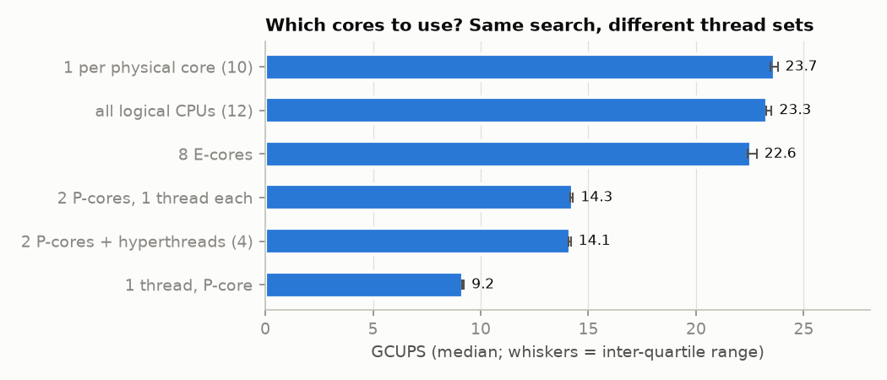
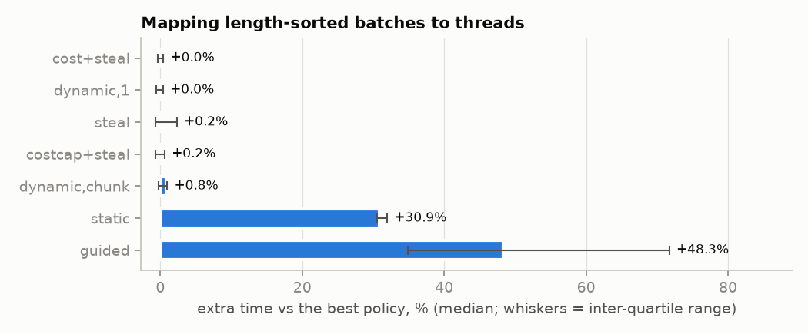
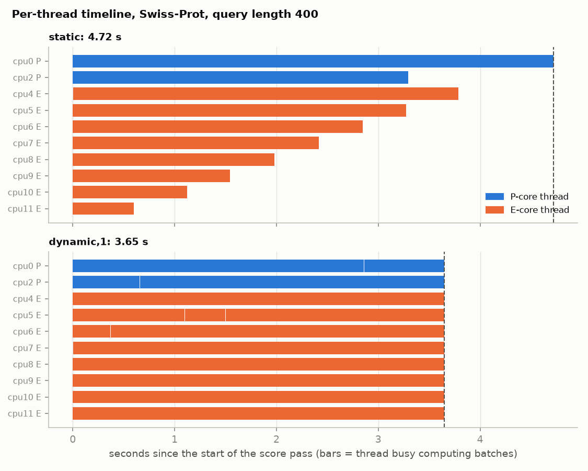
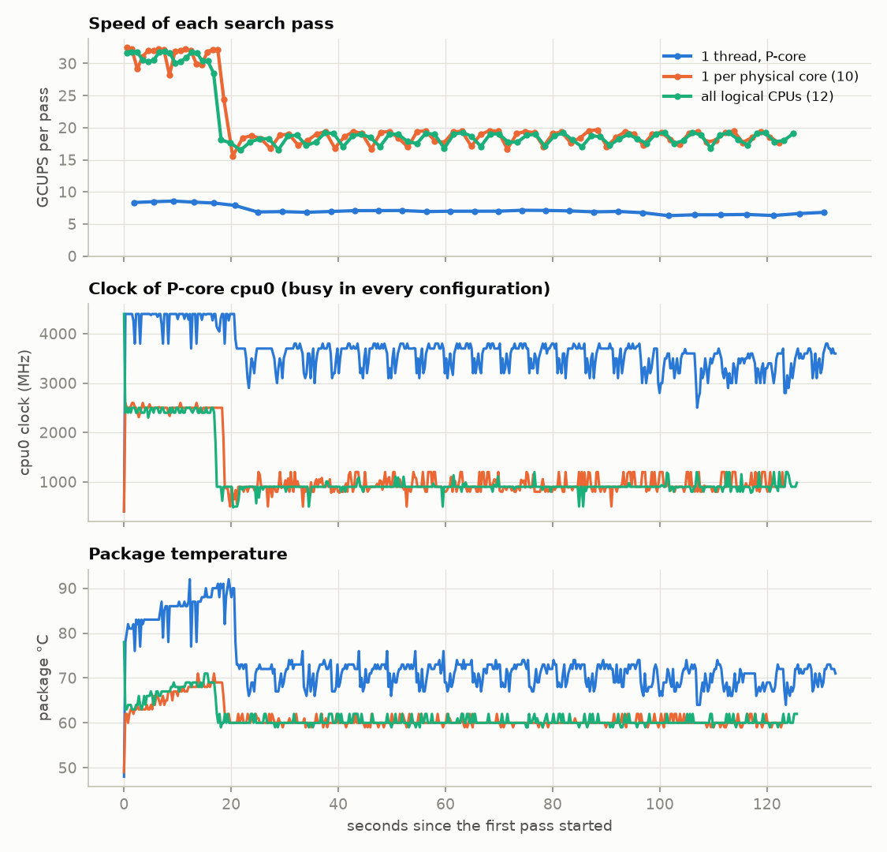
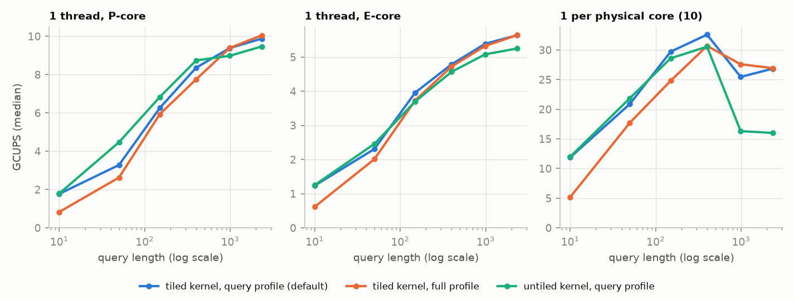
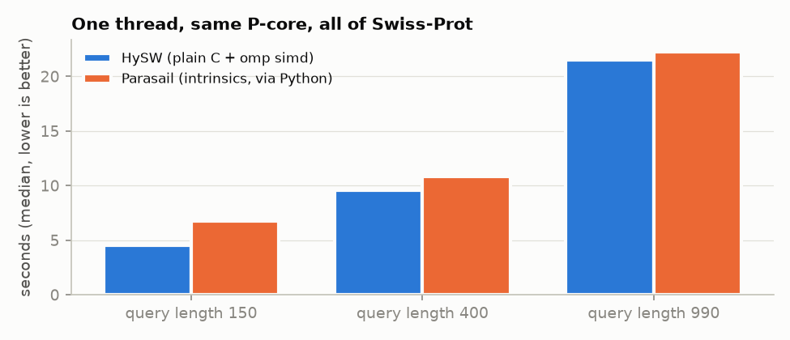
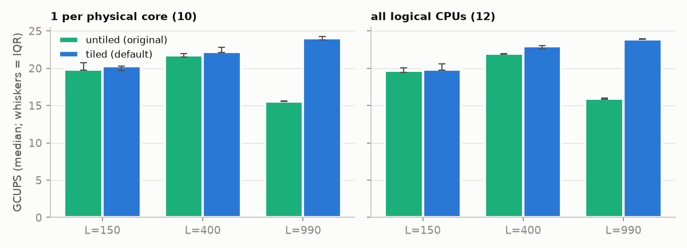

# M6 results — generated by `scripts/make_m6_report.py` from the raw files in this folder

All numbers are measured on the student's laptop (Intel i3-1220P, 2 P-cores + 8 E-cores). Medians over rounds; each round runs the configurations in a fresh random order, each measured pass preceded by the same 2 s all-core conditioning load (sustained regime) unless stated otherwise. Raw CSV, random orders (`*.meta.json`) and machine state (`*.sysinfo.txt`) are in this folder.

Engine: tiled SIMD kernel and query-only profile (the defaults, `DECISIONS.md` D3–D4); E5 and E7 also run the original untiled kernel for comparison. The first study, run with the untiled kernel, is kept in `results/m6_v1_untiled/`, together with the cache diagnosis that motivated the change.

## E1 — Speedup decomposition (Swiss-Prot, query length 400, sustained)
Recorded 2026-11-21T16:15:04+05:30: platform profile `balanced`, governor `powersave`, long-term power limit 15.0 W (MMIO zone; window 28.0 s), on AC: 1, package temperature at start 46.0 °C.

| Configuration | Threads | Median time (s) | IQR (% of median) | GCUPS | Speedup vs scalar | Step speedup |
|---|---|---|---|---|---|---|
| Scalar, 1 P-core thread | 1 | 117.85 | 0.6 | 0.71 | 1.0× | — |
| SIMD (16 lanes), 1 P-core thread | 1 | 9.30 | 0.3 | 9.00 | 12.7× | 12.67× |
| SIMD + threads (1 per physical core) | 10 | 3.70 | 3.2 | 22.63 | 31.9× | 2.52× |

Rounds per configuration: 5. Total speedup = SIMD step × thread step.

## E2 — Which cores? Thread sets (Swiss-Prot, 3 queries 150/400/990, SIMD, `dynamic,1`, sustained)
Recorded 2026-11-21T16:26:29+05:30: platform profile `balanced`, governor `powersave`, long-term power limit 15.0 W (MMIO zone; window 28.0 s), on AC: 1, package temperature at start 55.0 °C.

| Thread set | Threads | Median time (s) | IQR % | GCUPS | Speedup vs 1 thread | Regret vs best |
|---|---|---|---|---|---|---|
| 1 per physical core (10) | 10 | 13.62 | 1.4 | 23.65 | 2.57× | +0.0% |
| all logical CPUs (12) | 12 | 13.82 | 1.0 | 23.31 | 2.54× | +1.5% |
| 8 E-cores | 8 | 14.28 | 1.8 | 22.56 | 2.46× | +4.8% |
| 2 P-cores, 1 thread each | 2 | 22.56 | 1.0 | 14.28 | 1.55× | +65.6% |
| 2 P-cores + hyperthreads (4) | 4 | 22.77 | 0.8 | 14.15 | 1.54× | +67.2% |
| 1 thread, P-core | 1 | 35.07 | 1.1 | 9.19 | 1.00× | +157.4% |

Rounds: 9.

## E3 — Batch-to-thread mapping policies (Swiss-Prot, 3 queries, 1 thread per physical core, sustained)
Recorded 2026-11-21T16:50:15+05:30: platform profile `balanced`, governor `powersave`, long-term power limit 15.0 W (MMIO zone; window 28.0 s), on AC: 1, package temperature at start 55.0 °C.

| Policy | Median time (s) | IQR % | GCUPS | Regret vs best |
|---|---|---|---|---|
| `cost+steal` | 13.79 | 0.7 | 23.36 | +0.0% |
| `dynamic,1` | 13.80 | 0.9 | 23.35 | +0.0% |
| `steal` | 13.81 | 3.0 | 23.32 | +0.2% |
| `costcap+steal` | 13.82 | 1.3 | 23.32 | +0.2% |
| `dynamic,chunk` | 13.90 | 1.2 | 23.18 | +0.8% |
| `static` | 18.05 | 1.0 | 17.85 | +30.9% |
| `guided` | 20.46 | 24.8 | 15.75 | +48.3% |

Rounds: 9. Regret within the IQRs = tie.

## E4 — Burst → sustained (Swiss-Prot, query length 150, continuous repeated searches after a 60 s idle cool-down)
Recorded 2026-11-21T17:13:24+05:30: platform profile `balanced`, governor `powersave`, long-term power limit 15.0 W (MMIO zone; window 28.0 s), on AC: 1, package temperature at start 62.0 °C.

| Thread set | Passes | First pass GCUPS | Median of first 5 s | Median after 40 s | Drop |
|---|---|---|---|---|---|
| 1 thread, P-core | 30 | 8.3 | 8.3 | 6.9 | -17% |
| 1 per physical core (10) | 80 | 32.5 | 32.0 | 19.0 | -41% |
| all logical CPUs (12) | 80 | 31.7 | 31.7 | 18.7 | -41% |

Drop = median GCUPS after 40 s vs the first 5 s. The long-term power limit uses a 28 s averaging window.

## E5 — Query length × kernel variant × core type (E. coli × 20 = 27.1 M residues, sustained)
Recorded 2026-11-21T17:22:46+05:30: platform profile `balanced`, governor `powersave`, long-term power limit 15.0 W (MMIO zone; window 28.0 s), on AC: 1, package temperature at start 56.0 °C.

Median GCUPS per query (rounds: 5). *tiled* = column blocks of 16 (default), *untiled* = the original column-by-column loop; *query* profile = rows only for the query's residues (default), *full* = all 24 codes.

| Cores | Variant | L=10 | L=50 | L=150 | L=400 | L=990 | L=2339 |
|---|---|---|---|---|---|---|---|
| 1 thread, P-core | tiled kernel, query profile (default) | 1.77 | 3.28 | 6.26 | 8.36 | 9.39 | 9.88 |
| 1 thread, P-core | tiled kernel, full profile | 0.83 | 2.63 | 5.93 | 7.75 | 9.39 | 10.05 |
| 1 thread, P-core | untiled kernel, query profile | 1.79 | 4.47 | 6.83 | 8.74 | 8.98 | 9.47 |
| 1 thread, E-core | tiled kernel, query profile (default) | 1.24 | 2.31 | 3.96 | 4.79 | 5.39 | 5.64 |
| 1 thread, E-core | tiled kernel, full profile | 0.62 | 2.01 | 3.73 | 4.72 | 5.32 | 5.64 |
| 1 thread, E-core | untiled kernel, query profile | 1.25 | 2.46 | 3.70 | 4.57 | 5.08 | 5.25 |
| 1 per physical core (10) | tiled kernel, query profile (default) | 11.88 | 20.89 | 29.72 | 32.58 | 25.46 | 26.84 |
| 1 per physical core (10) | tiled kernel, full profile | 5.17 | 17.74 | 24.80 | 30.68 | 27.59 | 26.94 |
| 1 per physical core (10) | untiled kernel, query profile | 11.98 | 21.87 | 28.60 | 30.56 | 16.31 | 16.01 |

## E6 — Same-machine yardstick: Parasail vs HySW, one thread on P-core cpu0 (Swiss-Prot)
Recorded 2026-11-21T17:41:28+05:30: platform profile `balanced`, governor `powersave`, long-term power limit 15.0 W (MMIO zone; window 28.0 s), on AC: 1, package temperature at start 67.0 °C.

| Query length | HySW median (s) | Parasail median (s) | Parasail / HySW |
|---|---|---|---|
| 150 | 4.50 | 6.74 | 1.50 |
| 400 | 9.61 | 10.83 | 1.13 |
| 990 | 21.53 | 22.23 | 1.03 |
| all 3 | 35.65 (9.04 GCUPS) | 39.84 (8.09 GCUPS) | 1.12 |

Parasail: `sw_striped_profile_16` (hand-written intrinsics, best instruction set auto-selected) called once per database sequence from Python, so its time includes Python call overhead (~576k calls per query). Rounds: 3. Conditioning differs slightly: Parasail gets the 2 s load before each query, HySW once before its 3-query process. With 3 rounds, treat differences under ~10% as ties.

## E7 — Before/after the cache fix: untiled vs tiled SIMD kernel (Swiss-Prot, 3 queries, sustained)
Recorded 2026-11-21T17:45:53+05:30: platform profile `balanced`, governor `powersave`, long-term power limit 15.0 W (MMIO zone; window 28.0 s), on AC: 1, package temperature at start 56.0 °C.

Median GCUPS per query (rounds: 5); ratio = tiled / untiled.

| Cores | Query length | Untiled GCUPS (IQR) | Tiled GCUPS (IQR) | Tiled / untiled |
|---|---|---|---|---|
| 1 per physical core (10) | 150 | 19.85 (19.75–20.77) | 20.28 (19.66–20.30) | 1.02× |
| 1 per physical core (10) | 400 | 21.70 (21.48–21.99) | 22.20 (22.09–22.81) | 1.02× |
| 1 per physical core (10) | 990 | 15.54 (15.51–15.65) | 24.00 (23.77–24.29) | 1.54× |
| all logical CPUs (12) | 150 | 19.69 (19.44–20.09) | 19.82 (19.76–20.57) | 1.01× |
| all logical CPUs (12) | 400 | 21.98 (21.86–22.00) | 23.00 (22.59–23.02) | 1.05× |
| all logical CPUs (12) | 990 | 15.91 (15.85–15.97) | 23.91 (23.90–23.96) | 1.50× |

