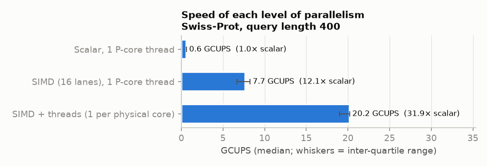
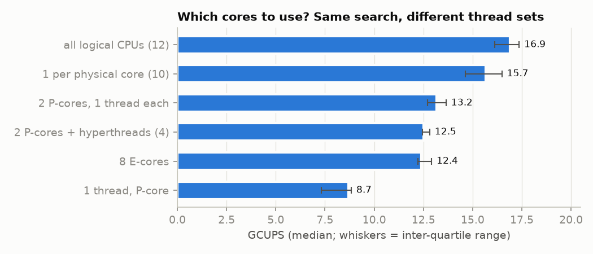
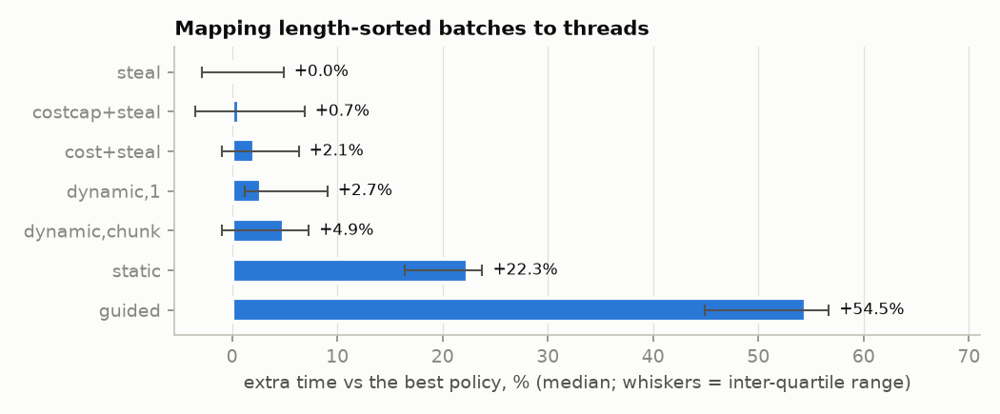
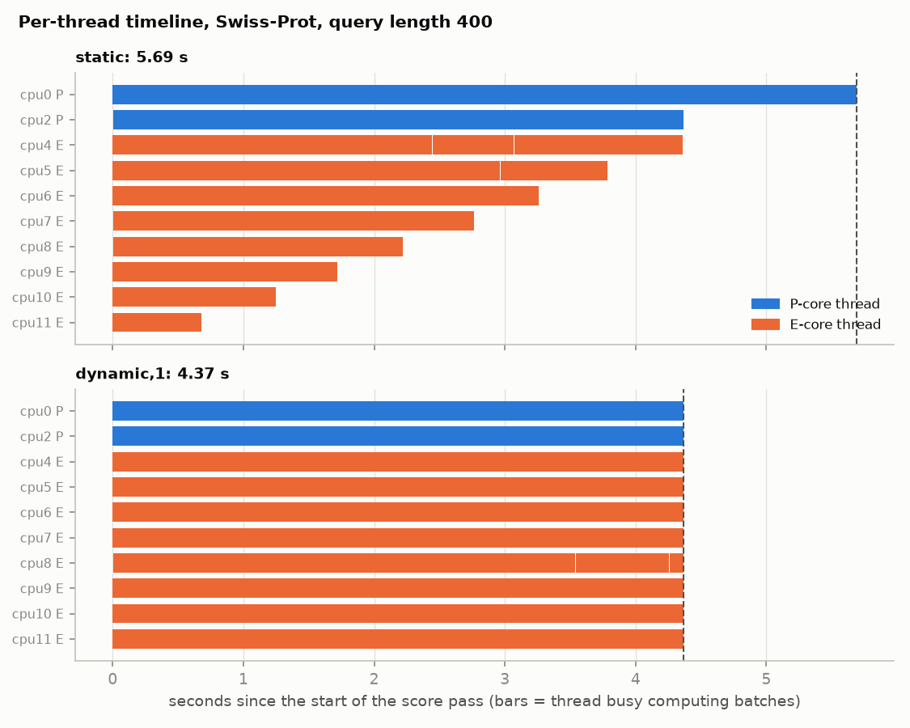
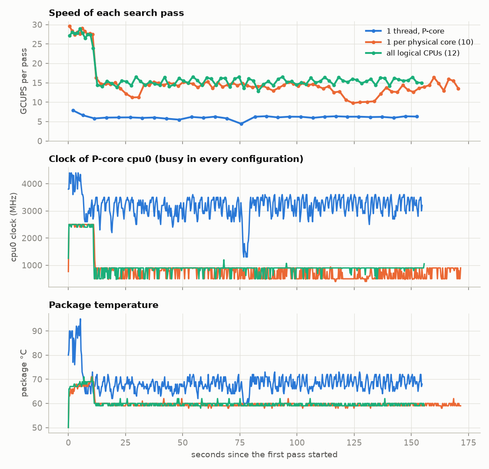
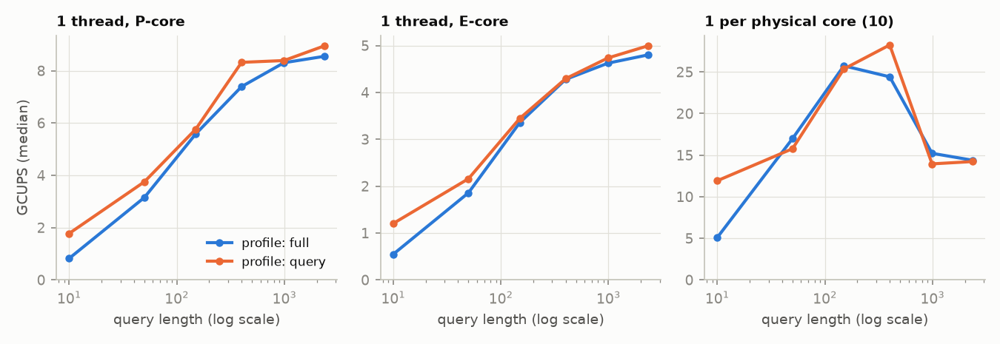
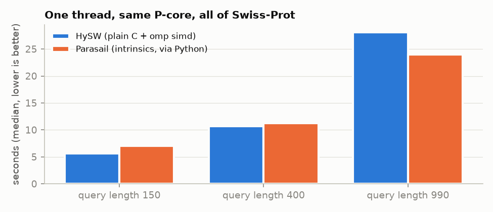

# M6 results — generated by `scripts/make_m6_report.py` from the raw files in this folder

All numbers are measured on the student's laptop (Intel i3-1220P, 2 P-cores + 8 E-cores). Medians over rounds; each round runs the configurations in a fresh random order, each measured pass preceded by the same 2 s all-core conditioning load (sustained regime) unless stated otherwise. Raw CSV, random orders (`*.meta.json`) and machine state (`*.sysinfo.txt`) are in this folder.

## E1 — Speedup decomposition (Swiss-Prot, query length 400, sustained)
Recorded 2026-11-20T23:28:59+05:30: platform profile `balanced`, governor `powersave`, long-term power limit 15.0 W (MMIO zone; window 28.0 s), on AC: 1, package temperature at start 55.0 °C.

| Configuration | Threads | Median time (s) | IQR (% of median) | GCUPS | Speedup vs scalar | Step speedup |
|---|---|---|---|---|---|---|
| Scalar, 1 P-core thread | 1 | 132.14 | 0.5 | 0.63 | 1.0× | — |
| SIMD (16 lanes), 1 P-core thread | 1 | 10.91 | 22.1 | 7.67 | 12.1× | 12.12× |
| SIMD + threads (1 per physical core) | 10 | 4.14 | 6.6 | 20.21 | 31.9× | 2.63× |

Rounds per configuration: 5. Total speedup = SIMD step × thread step.

## E2 — Which cores? Thread sets (Swiss-Prot, 3 queries 150/400/990, SIMD, `dynamic,1`, sustained)
Recorded 2026-11-20T23:41:54+05:30: platform profile `balanced`, governor `powersave`, long-term power limit 15.0 W (MMIO zone; window 28.0 s), on AC: 1, package temperature at start 58.0 °C.

| Thread set | Threads | Median time (s) | IQR % | GCUPS | Speedup vs 1 thread | Regret vs best |
|---|---|---|---|---|---|---|
| all logical CPUs (12) | 12 | 19.07 | 7.4 | 16.89 | 1.95× | +0.0% |
| 1 per physical core (10) | 10 | 20.58 | 12.0 | 15.65 | 1.80× | +7.9% |
| 2 P-cores, 1 thread each | 2 | 24.47 | 7.1 | 13.16 | 1.52× | +28.3% |
| 2 P-cores + hyperthreads (4) | 4 | 25.78 | 2.9 | 12.50 | 1.44× | +35.1% |
| 8 E-cores | 8 | 26.01 | 5.5 | 12.39 | 1.43× | +36.4% |
| 1 thread, P-core | 1 | 37.12 | 20.5 | 8.68 | 1.00× | +94.6% |

Rounds: 9.

## E3 — Batch-to-thread mapping policies (Swiss-Prot, 3 queries, 1 thread per physical core, sustained)
Recorded 2026-11-21T00:10:42+05:30: platform profile `balanced`, governor `powersave`, long-term power limit 15.0 W (MMIO zone; window 28.0 s), on AC: 1, package temperature at start 56.0 °C.

| Policy | Median time (s) | IQR % | GCUPS | Regret vs best |
|---|---|---|---|---|
| `steal` | 20.00 | 7.8 | 16.11 | +0.0% |
| `costcap+steal` | 20.14 | 10.3 | 16.00 | +0.7% |
| `cost+steal` | 20.43 | 7.2 | 15.77 | +2.1% |
| `dynamic,1` | 20.55 | 7.6 | 15.68 | +2.7% |
| `dynamic,chunk` | 20.98 | 7.8 | 15.35 | +4.9% |
| `static` | 24.47 | 6.0 | 13.17 | +22.3% |
| `guided` | 30.90 | 7.6 | 10.43 | +54.5% |

Rounds: 9. Regret within the IQRs = tie.

## E4 — Burst → sustained (Swiss-Prot, query length 150, continuous repeated searches after a 60 s idle cool-down)
Recorded 2026-11-21T00:40:39+05:30: platform profile `balanced`, governor `powersave`, long-term power limit 15.0 W (MMIO zone; window 28.0 s), on AC: 1, package temperature at start 55.0 °C.

| Thread set | Passes | First pass GCUPS | Median of first 5 s | Median after 40 s | Drop |
|---|---|---|---|---|---|
| 1 thread, P-core | 30 | 7.9 | 7.9 | 6.2 | -21% |
| 1 per physical core (10) | 80 | 29.6 | 28.2 | 14.2 | -50% |
| all logical CPUs (12) | 80 | 27.2 | 27.8 | 15.5 | -44% |

Drop = median GCUPS after 40 s vs the first 5 s. The long-term power limit uses a 28 s averaging window.

## E5 — Query length × SIMD profile option × core type (E. coli × 20 = 27.1 M residues, sustained)
Recorded 2026-11-21T00:51:42+05:30: platform profile `balanced`, governor `powersave`, long-term power limit 15.0 W (MMIO zone; window 28.0 s), on AC: 1, package temperature at start 55.0 °C.

Median GCUPS per query (rounds: 5). *full* = profile rows for all 24 residue codes; *query* = only the query's residues.

| Cores | Profile | L=10 | L=50 | L=150 | L=400 | L=990 | L=2339 |
|---|---|---|---|---|---|---|---|
| 1 thread, P-core | full | 0.82 | 3.15 | 5.58 | 7.39 | 8.30 | 8.55 |
| 1 thread, P-core | query | 1.78 | 3.75 | 5.76 | 8.32 | 8.39 | 8.95 |
| 1 thread, E-core | full | 0.55 | 1.86 | 3.36 | 4.28 | 4.62 | 4.80 |
| 1 thread, E-core | query | 1.20 | 2.16 | 3.45 | 4.29 | 4.74 | 5.00 |
| 1 per physical core (10) | full | 5.09 | 16.98 | 25.74 | 24.42 | 15.22 | 14.39 |
| 1 per physical core (10) | query | 11.92 | 15.77 | 25.36 | 28.24 | 13.95 | 14.22 |

The drop for long queries on 10 threads is caused by the four E-cores of a cluster sharing one 2 MB L2: the per-thread H/E arrays (64 B × query length) leave L1 above ~L=500 and the shared L2 saturates. Diagnosis (exploratory, not part of the randomised protocol): `EXPLORATORY_e5_cache_diagnosis.md`.

## E6 — Same-machine yardstick: Parasail vs HySW, one thread on P-core cpu0 (Swiss-Prot)
Recorded 2026-11-21T01:05:22+05:30: platform profile `balanced`, governor `powersave`, long-term power limit 15.0 W (MMIO zone; window 28.0 s), on AC: 1, package temperature at start 67.0 °C.

| Query length | HySW median (s) | Parasail median (s) | Parasail / HySW |
|---|---|---|---|
| 150 | 5.66 | 7.00 | 1.24 |
| 400 | 10.68 | 11.29 | 1.06 |
| 990 | 28.08 | 24.01 | 0.86 |
| all 3 | 43.99 (7.32 GCUPS) | 42.55 (7.57 GCUPS) | 0.97 |

Parasail: `sw_striped_profile_16` (hand-written intrinsics, best instruction set auto-selected) called once per database sequence from Python, so its time includes Python call overhead (~576k calls per query). Rounds: 3. Conditioning differs slightly: Parasail gets the 2 s load before each query, HySW once before its 3-query process. With 3 rounds, treat differences under ~10% as ties.

